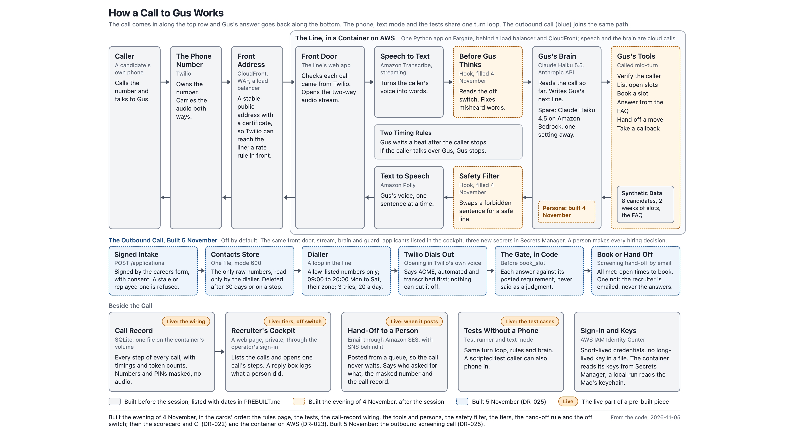
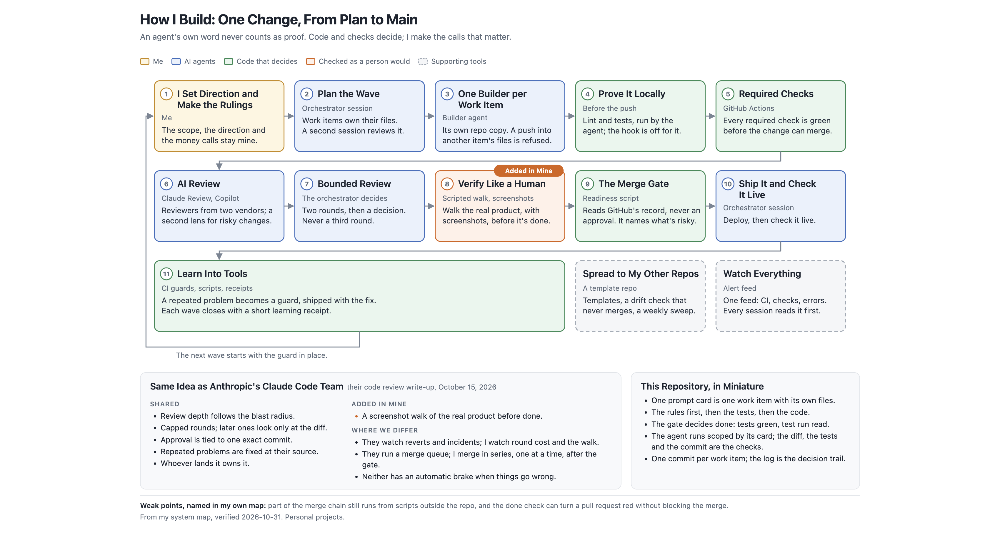

# Candidate Line

A phone line for the job candidates of ACME, a fictional firm, designed so that a voice agent called Gus books a first-round interview, answers process questions from an FAQ and names the section, takes a callback request, and never evaluates a person. What runs today is the plumbing: a real phone path, a text mode, the tests, an eval runner, a trace store (the call record in the picture) and the cockpit, the recruiter's page. Gus himself (the spec, the persona, the tools, the guard and the eval cases) was to be built in a one-hour live session on 4 November 2026 and was not, because the hour went to another topic, so the phone and text mode run on a placeholder prompt that carries only the rule never to evaluate a person, with no FAQ, no tools and no guard (text mode repeats what you type with `BRAIN_PROVIDER=echo`), and `make eval` finds no cases. All data is synthetic. No account, key or phone number is in this repository.

The author is James Shehan; "James" in the files is him. The tree was built with Claude Code from the numbered items in `KICKOFF.md`, with every decision written down as it was made; the seven cards in `prompts/` were for the session, and were dry-run twice in scratch copies (`docs/decisions/DR-015`). The files call that live session "the room" or "the hour"; "the session" in this README means the same thing.



Grey boxes were built before the session, each with its commit in `PREBUILT.md`. Orange boxes were planned for the session and do not exist yet.

## Five Minutes, in This Order

The records are long, so start here:

1. [`PREBUILT.md`](PREBUILT.md): what existed before the session, with the commit of each item, and what landed after the tag `prebuilt-2026-11-03`.
2. [`docs/decisions/DR-001-voice-path.md`](docs/decisions/DR-001-voice-path.md): the rule written before measuring, the numbers, and why arm A was kept when the rule picked arm B.
3. [`AGENTS.md`](AGENTS.md): the rules every coding agent here follows. `.claude/settings.json` lists the commands it may run without asking: the tests, the evals (a few cents of model calls), lint checks and git reads.
4. [`prompts/01-spec-from-problem-card.md`](prompts/01-spec-from-problem-card.md): one of the seven cards. Each names its files, its acceptance criteria and the questions it asks before it writes anything.
5. [`candidate_line/turn.py`](candidate_line/turn.py) and [`tests/`](tests/): the one turn loop that the phone, text mode and the evals share.

`KICKOFF.md` is the plan for the build days of 1 to 3 November, kept as it was written. Where it and a decision record disagree, the record is newer. The records' Status lines say DRAFT: each is reviewed after the session.

## Run It

With `uv` installed (`brew install uv` on a Mac, or the installer on uv's own site; the project pins Python 3.12):

```
make test                       # the test suite, no account needed
BRAIN_PROVIDER=echo make text   # text mode with no account: Gus says back what you type; /quit ends it
make text                       # text mode on Claude Haiku 5.5; needs ANTHROPIC_API_KEY in the environment
make eval                       # the eval cases through the same turn loop the phone uses; none exist yet, so it reports 0 cases
```

The phone path (`make up`, `make dev`, `make probe-dial`) needs an AWS account for transcription and speech, a Twilio number, and an Anthropic key. None of those is here, and `docs/decisions/DR-002` says how the account was set up without a long-lived key in any file. The code, data and prose are under the MIT license (`LICENSE`); `docs/refs/` holds vendor material under its own terms.

## How It Was Built



The picture is how I run builds across my own repositories. Here only steps 1 and 8 show in full, my rulings and the real calls, with `AGENTS.md` rule 3 standing in for step 3; the pre-push hook, the CI, the AI review and the merge gate run in my other repositories, and this one has no CI and no pull requests. What this tree does show: each component landed with its tests and a decision record, and every fix after a live call is in a record's evidence; the pre-built list was declared and tagged before the session; the phone path was proven by real calls (`docs/decisions/DR-006`); and the voice path was measured against a rule written first (`docs/decisions/DR-001`). The pattern is close to the one the Claude Code team described for their own code review in October 2026 ([their write-up](https://claude.dev/blog/solving-code-review-at-anthropic/)), with one addition: a person walks the result the way a user would before it counts.

## The Pages

Everything made for the session is in [`docs/showcase/`](docs/showcase/README.md): the architecture above, [how I build](docs/showcase/README.md#how-i-build-one-change-from-plan-to-main), [the one-page version for a business lead](docs/showcase/README.md#the-candidate-line-for-the-business-lead) and [the cockpit redesigned for the recruiting lead](docs/showcase/README.md#the-cockpit-redesigned-for-the-recruiting-lead), each as a picture and as a page; three of the four have notes that trace every line on them to a file in this tree, at the commit the notes name. The pre-built list is [`PREBUILT.md`](PREBUILT.md); the decision records are in [`docs/decisions/`](docs/decisions/); the seven cards are in [`prompts/`](prompts/).

## The Session of 4 November 2026

The tag `room-2026-11-04` marks the tree as it was when the session opened. Gus was not built in the session, so the files the cards write (`spec.md`, the eval cases, `DR-016` onward, the persona, the guard) are not here: `candidate_line/persona.py` still holds the placeholder text mode runs on, and `evals/cases/` is empty. What you are reading is the setup: the plumbing, the rules, the records and the cards.

## What Gus Must Never Do

The problem card in `prompts/01` sets the lines the session builds into the persona, the guard and the eval set: no score, ranking, opinion, comparison or predicted outcome about a caller; no answer to a process question from anywhere but the FAQ; never pass for a person. A person makes every judgment about a candidate; the line only books, answers and hands off.
