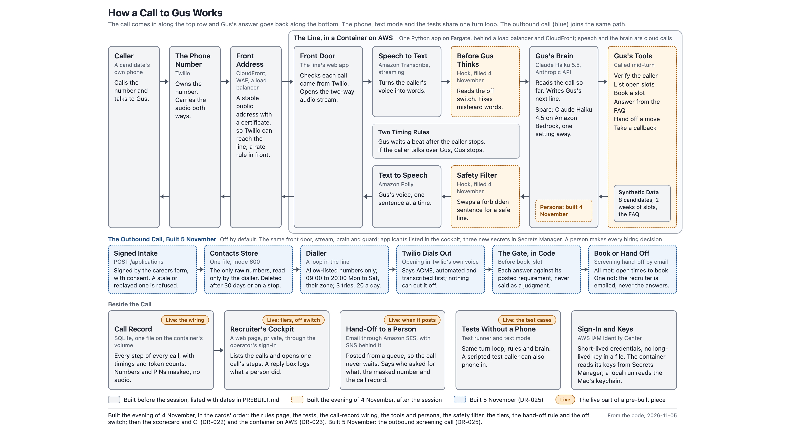
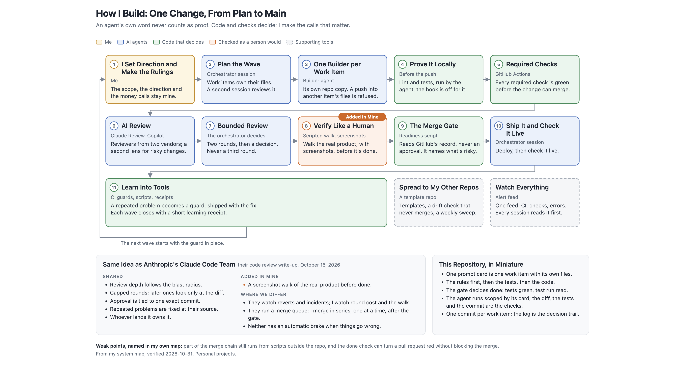
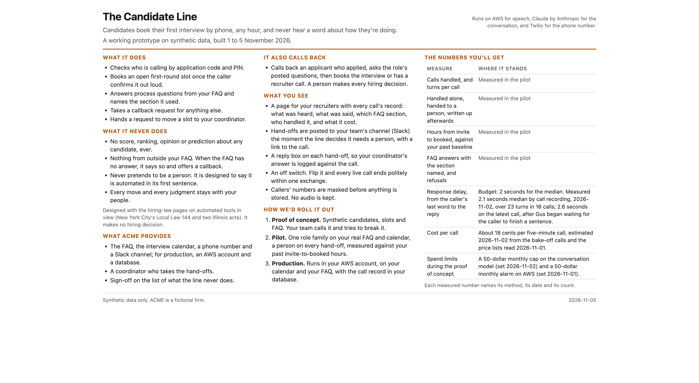
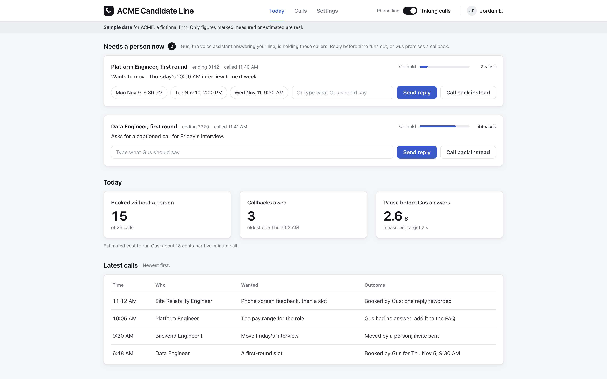

# The Pages Made for the Session

Four pages drawn from this repository's code and records on 2026-11-03, for the session; the architecture and the business lead's page were brought up to date on 2026-11-05 for the outbound call. Each is here as a picture and as the page itself (on GitHub a click on an `.html` file shows its source; download it to see the page). Three of the four have notes that say where every line on them comes from, with file and line references into this repository.

## How a Call to Gus Works

The phone path, the brain, the records and the cockpit. Grey boxes were built before the session; orange boxes were built on the evening of 4 November, after it; the blue band is the outbound call, built on 5 November (DR-025). Page: [architecture.html](architecture.html). Notes: [architecture-notes.md](architecture-notes.md).

## How I Build: One Change, From Plan to Main

The system every build of mine runs under, numbered one to eleven, with what proves each box, and how it compares with the Claude Code team's own code review write-up of October 2026. Page: [how-i-build.html](how-i-build.html). No notes: this page describes how the author's repositories are run in general, and only part of it shows here.

## The Candidate Line, for the Business Lead

The one-page, non-technical version: what it does, what it never does, what the client gets, what it costs, how it rolls out. It describes the line as built: the tools, the guard, the tiers and the off switch landed on the evening of 4 November (records DR-019 to DR-021), and the outbound call on 5 November (DR-025). Page: [customer.html](customer.html). Notes: [customer-notes.md](customer-notes.md).

## The Cockpit, Redesigned for the Recruiting Lead

The design of the screen the recruiting lead opens in the morning: who needs a person now, three numbers for the day, the latest calls. Sample data. The live cockpit in `candidate_line/traces/cockpit.py` reads the real call record. Page: [cockpit-design.html](cockpit-design.html). Notes: [cockpit-design-notes.md](cockpit-design-notes.md).
